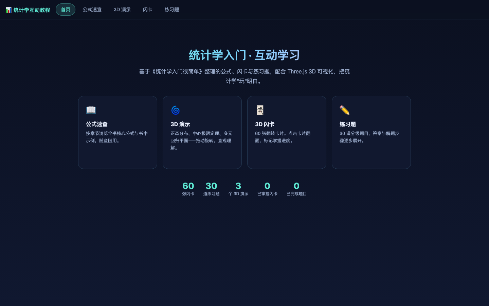
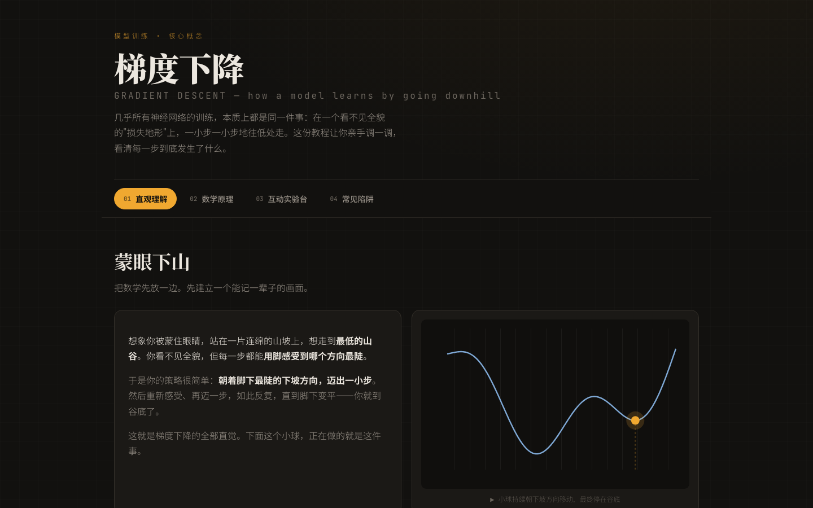
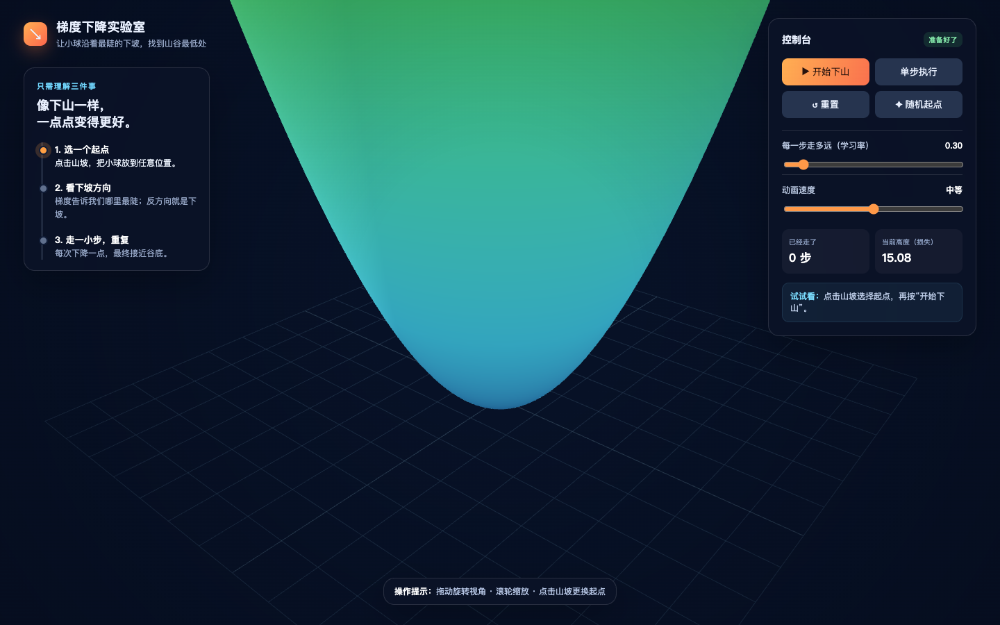
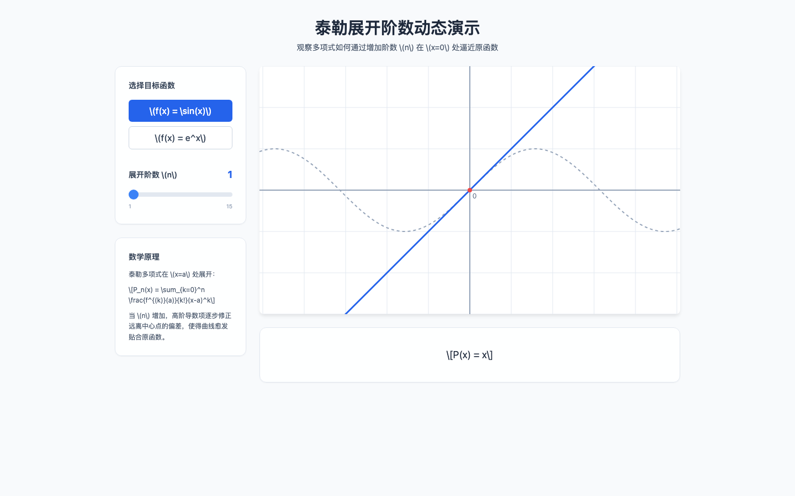

# 交互教程合集

浏览器交互教程与学习实验，下载后使用现代浏览器打开 HTML 文件即可查看。

| 专题 | 入口 | 截图 | 说明 |
| --- | --- | --- | --- |
| 统计学互动教程 | [打开教程](统计学/统计学互动教程.html) |  | 附公式手册、闪卡和练习题。 |
| 跨境电商出海：12 周互动实战 | [打开教程](跨境电商/index.html) |  | 包含本地 CSS 和 JavaScript；图标与庆祝动画使用外部 CDN。 |
| 跨境电商出海：12 周学习计划 | [打开教程](跨境电商/gemini-web.html) |  | 同主题的另一版页面；样式和图标使用外部 CDN。 |
| 30 天广告投放互动教程 | [打开教程](广告投放/ad-learning-interactive-tutorial.html) |  | 30 天投放训练与学习记录。 |
| 001 · MathVision 高等数学教程 | [打开教程](001-高等数学/index.html) |  | 未发现外部资源引用。 |
| 002 · 梯度下降互动教学 | [打开教程](002-梯度下降教学/index.html) |  | 使用 Google Fonts。 |
| 003 · 梯度下降互动小实验 | [打开教程](003-梯度下降实验/index.html) |  | 使用 Three.js CDN。 |
| 004 · 泰勒展开阶数动态演示 | [打开教程](004-泰勒展开/index.html) |  | 使用 Tailwind CSS CDN。 |

依赖在线资源的页面需要联网以获得完整效果。页面若使用浏览器本地存储保存学习记录，记录保存在当前浏览器中，不会随 Git 仓库同步。
